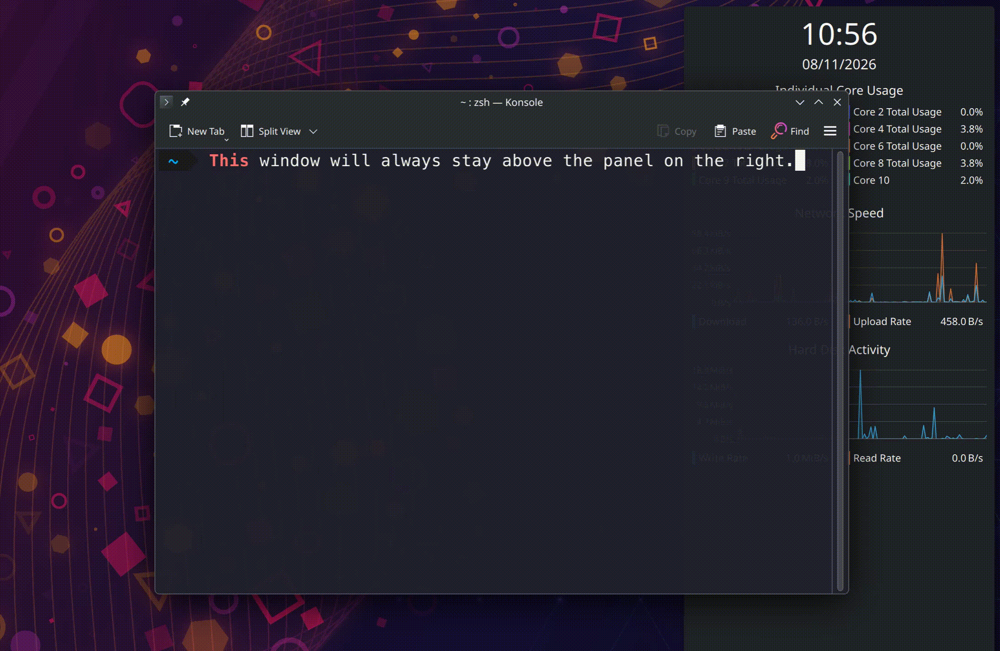

# Panel in Background

[](LICENSE)
[](https://github.com/matthetherington/plasma-panel-in-background/releases/latest)
[](docs/COMPATIBILITY.md)
[](docs/COMPATIBILITY.md)

Keep KDE Plasma panels **above the wallpaper but behind application windows**.
Windows cover only the parts they overlap; the rest of the panel stays visible
and usable. Panels don't hide, reserve screen space, or rise at the screen edge.

Add one small QML widget to each panel you want to control. No native plugin,
root access or Plasma rebuild is needed to install the widget itself. Installing
missing system dependencies may require administrator access.



*Windows cover only the parts of the panel they overlap.*

## Motivation

Plasma 5 had a similar **Windows Can Cover** mode. It was removed in Plasma 6
and replaced with **Dodge Windows**; KDE's developers have
[said there are no plans to bring the old mode back](https://bugs.kde.org/show_bug.cgi?id=486701#c1).

Plasma 6's built-in visibility modes are:

- **Always visible:** stays above windows and reserves screen space.
- **Auto hide:** hides until you move the pointer to the screen edge.
- **Dodge windows:** hides the whole panel when a window overlaps it.
- **Windows go below:** stays above windows without reserving screen space.

None keeps the panel permanently behind application windows while leaving its
uncovered parts visible. This widget adds that behaviour. Unlike the old
Windows Can Cover mode, it doesn't raise the panel when you touch the screen edge.

## Requirements

- KDE Plasma **6** on **Wayland**.
- LayerShellQt's `org.kde.layershell` QML module, `org.kde.kwindowsystem`,
  and Plasma's shell QML APIs, supplied by your distribution.
- `kpackagetool6` to install from a terminal.

Tested on Plasma **6.8.2** with Fedora Asahi Remix 45 development on ARM64.
Other configurations are unverified. See [compatibility](docs/COMPATIBILITY.md).

## Set up your distribution

Start with an existing Plasma 6 desktop and select **Plasma (Wayland)** at login.
Install the runtime QML modules and terminal installation tool using the commands
for your distribution below. Plasma's shell QML APIs come with the desktop;
no development packages or compiler are needed.

These commands cover package installation, not additional tested configurations.
Package availability depends on your distribution release: Plasma 5 releases
(such as Ubuntu/Kubuntu 24.04) are not supported.

### Debian / Ubuntu / Kubuntu (Plasma 6 releases)

```sh
sudo apt update
sudo apt install qml6-module-org-kde-layershell qml6-module-org-kde-kwindowsystem kpackagetool6
```

The separate `qml6-module-org-kde-layershell` package is required even if the
LayerShellQt library is already installed. It supplies the `org.kde.layershell`
import reported missing in [issue #1](https://github.com/matthetherington/plasma-panel-in-background/issues/1).

### Fedora KDE / Fedora Asahi Remix

```sh
sudo dnf install layer-shell-qt kf6-kwindowsystem kf6-kpackage
```

### Arch Linux / EndeavourOS

```sh
sudo pacman -Syu --needed layer-shell-qt kwindowsystem kpackage
```

This performs a full system upgrade as well as installing the packages, avoiding
an unsupported partial upgrade on Arch-based systems.

### openSUSE Tumbleweed / Leap (Plasma 6 releases)

```sh
sudo zypper refresh
sudo zypper install layer-shell-qt6-imports kf6-kwindowsystem-imports kf6-kpackage
```

### After installing dependencies

Log out and back into **Plasma (Wayland)**, then install the widget below.
If an existing widget shows `module "org.kde.layershell" is not installed`, run
your distribution's setup commands and log out and back in before trying again.
If a package cannot be found, check that your release provides Plasma 6 and the
Qt 6 QML modules above; Qt 5 equivalents will not work.

## Install

Download the `.plasmoid` file from the
[latest release](https://github.com/matthetherington/plasma-panel-in-background/releases/latest),
then install it, adjusting the path and version as needed:

```sh
kpackagetool6 --type Plasma/Applet --install ./plasma-panel-in-background-0.4.2.plasmoid
```

Run this as your desktop user, without `sudo`. To build from source, see
[development instructions](docs/DEVELOPMENT.md).

Installing the package does not automatically add or enable the widget. Follow
these steps for each panel you want to control:

1. Right-click your panel and enter **Edit Mode**.
2. Choose **Add Widgets**, search for **Panel in Background**, and add it to that panel.
3. Right-click its small **P** control and choose **Enable behind windows**.
4. Leave Edit Mode. The control disappears and takes no panel space.

Repeat for other panels as needed. The widget starts disabled and preserves your
existing panel layout.

## Behaviour

- To configure it, enter Edit Mode and right-click the small **P↓** control. Choose
  **Disable behind windows** to restore the previous visibility setting.
- The control appears in Edit Mode even when disabled, so you can always re-enable it.
- Settings survive logouts and desktop-shell restarts.
- Launcher and menu popups can open above applications without raising the panel.
- Choosing a different visibility mode in Plasma's panel settings disables the widget.
- Removing the widget restores the previous mode. Duplicate controllers are rejected.
- Plasma may temporarily reserve space for panel controls in Edit Mode.

## Upgrade

```sh
kpackagetool6 --type Plasma/Applet --upgrade ./plasma-panel-in-background-0.4.2.plasmoid
```

Use the new version's filename, then log out and back in to load the updated widget.

## Disable or uninstall

Enter Edit Mode and use the control's right-click menu to disable it. To uninstall,
remove **Panel in Background** from every panel before removing the package:

```sh
kpackagetool6 --type Plasma/Applet --remove io.github.matthetherington.plasma.panelinbackground
```

Can't reach the widget? See [troubleshooting and recovery](docs/TROUBLESHOOTING.md).

## Licence and acknowledgements

Licensed under [MIT](LICENSE). KDE/Qt dependencies retain their own licences
and aren't bundled.

Inspired by
[plasma-panel-windows-can-cover](https://github.com/benjiman/plasma-panel-windows-can-cover)
and KDE's APIs. This is an independent QML implementation and includes none of that
project's code. It is not an official KDE add-on.
